# Entrega 2 — Diseño y planificación

**Proyecto:** TallerYa · **Cliente:** Taller mecánico · **Integrantes:** Devia Lautaro, Di Prinzio Pedro y Ruesga Lautaro

> Los diagramas están en Mermaid: GitHub los muestra como imagen al abrir este archivo.

## 1. Casos de uso

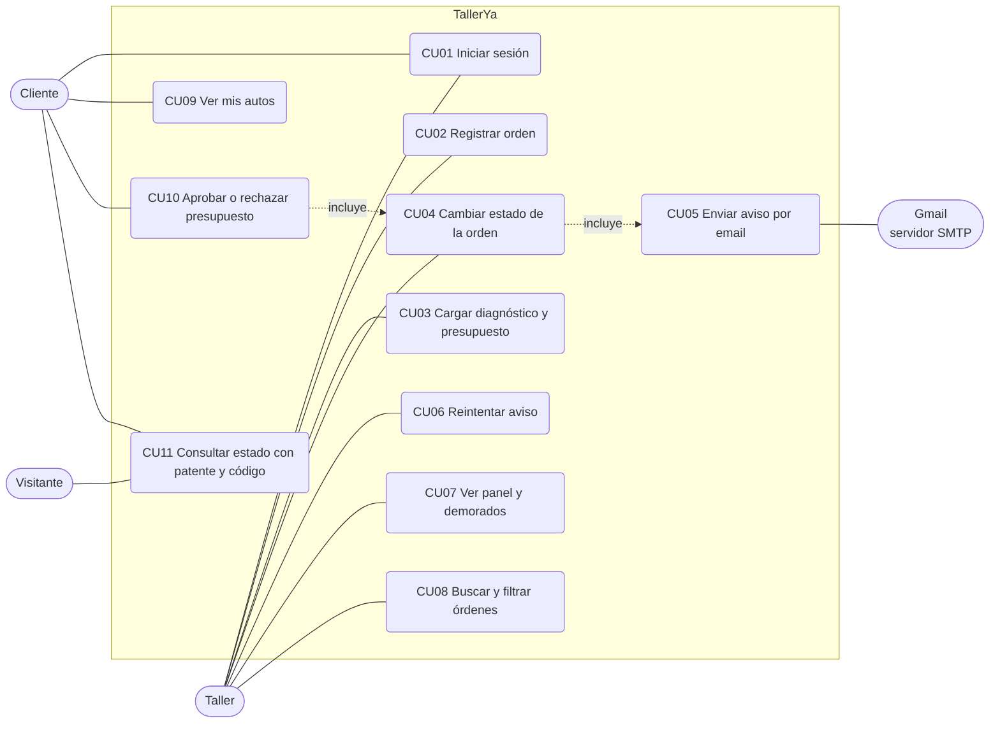

### CU04 — Cambiar estado de la orden
| | |
|---|---|
| **Actor** | Taller (o Cliente, solo para aprobar/rechazar) |
| **Precondición** | Sesión iniciada; la orden existe |
| **Flujo principal** | 1. El taller abre el detalle de la orden. 2. El sistema muestra solo los estados a los que se puede pasar. 3. El taller elige uno y opcionalmente escribe un comentario. 4. El sistema valida la transición, guarda el estado y registra el historial. 5. Si el nuevo estado es *Presupuesto listo* o *Listo para retirar*, ejecuta CU05. 6. Muestra "Estado actualizado". |
| **Alternativo 4a** | La transición no es válida (o se quiere presupuestar sin ítems): se muestra el error y no se cambia nada. |
| **Alternativo 5a** | El email falla: el estado queda cambiado, el aviso se guarda como "Falló" y se muestra un mensaje para reintentar o llamar. |
| **Postcondición** | La orden tiene el estado nuevo y queda en el historial. |

### CU10 — Aprobar o rechazar presupuesto
| | |
|---|---|
| **Actor** | Cliente |
| **Precondición** | El cliente inició sesión; la orden es suya y está en *Presupuesto listo* |
| **Flujo principal** | 1. El cliente entra a *Mis autos* y toca *Ver presupuesto*. 2. El sistema muestra el detalle y el total. 3. El cliente toca *Aprobar*. 4. El sistema ejecuta CU04 (a *Aprobado*) con el comentario "Aprobado por el cliente desde la web". 5. Muestra la confirmación. |
| **Alternativo 3a** | El cliente toca *Rechazar*: el sistema pide confirmación y pasa la orden a *Rechazado*. |
| **Excepción** | La orden es de otro cliente: el sistema responde "Orden no encontrada". |

### CU11 — Consultar estado con patente y código
| | |
|---|---|
| **Actor** | Visitante o Cliente |
| **Flujo principal** | 1. Ingresa patente y código. 2. El sistema valida el formato. 3. Busca la orden. 4. Muestra estado, recorrido y presupuesto. |
| **Alternativo** | No coincide: "No encontramos ninguna orden con esa patente y ese código". |

## 2. Arquitectura

Arquitectura **cliente-servidor** en capas, tipo MVC simplificado sin framework:

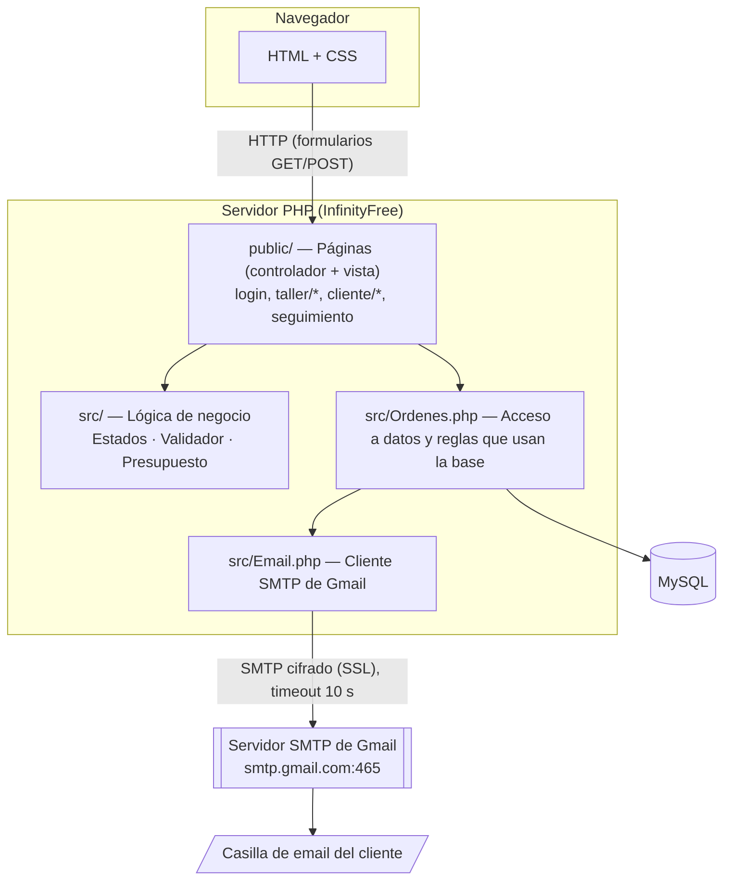

- **public/**: cada página recibe el pedido, valida los datos, llama a la lógica y arma el HTML con `layout.php` (mismo encabezado y menú en todo el sitio).
- **src/Estados.php, Validador.php, Presupuesto.php**: reglas puras, sin base de datos, para poder probarlas solas.
- **src/Ordenes.php**: operaciones sobre la base con PDO y sentencias preparadas; usa transacciones al cambiar de estado.
- **src/Email.php**: encapsula la API externa. Nunca tira excepción: devuelve `ok` o el error, así una caída de Gmail no rompe el sistema.

## 3. Modelo de datos (DER)

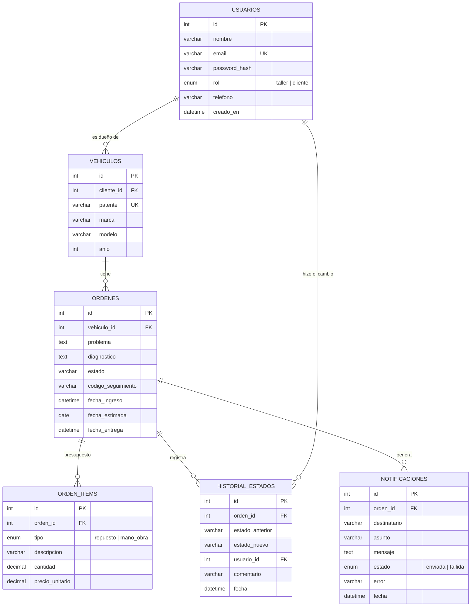

Decisiones:
- El **total del presupuesto no se guarda**: se calcula sumando los ítems, así nunca queda desactualizado (evita datos redundantes, 3FN).
- El vehículo está separado de la orden porque el mismo auto vuelve varias veces.
- El historial guarda quién hizo cada cambio: sirve para saber si el presupuesto lo aprobó el cliente o el taller.

### Diagrama de estados de una orden (Menú B)

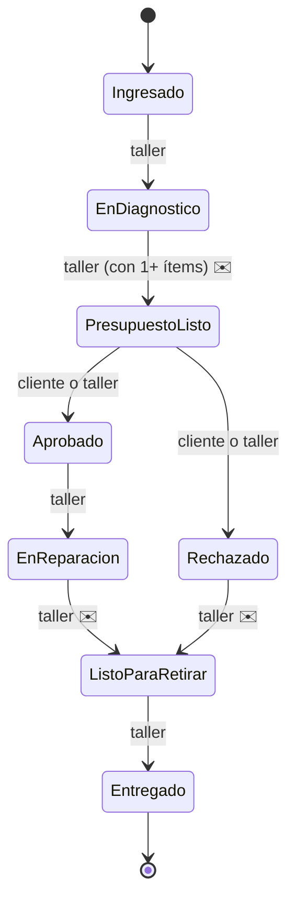
✉️ = se manda email al cliente. Alerta de **demora**: la orden está en Ingresado, En diagnóstico, Presupuesto listo, Aprobado o En reparación y ya pasó la fecha estimada.

## 4. Diseño de pantallas

**Estilo común a todo el sitio:** barra superior azul oscuro (`#1f3a5f`) con el logo y el menú según el rol; botones de acción naranja (`#e8772e`); tarjetas blancas sobre fondo gris claro; cada estado tiene siempre el mismo color de etiqueta. Una sola hoja de estilos: `public/css/estilos.css`.

| # | Pantalla | Rol | Imagen |
|---|---|---|---|
| 1 | Ingresar | Todos | 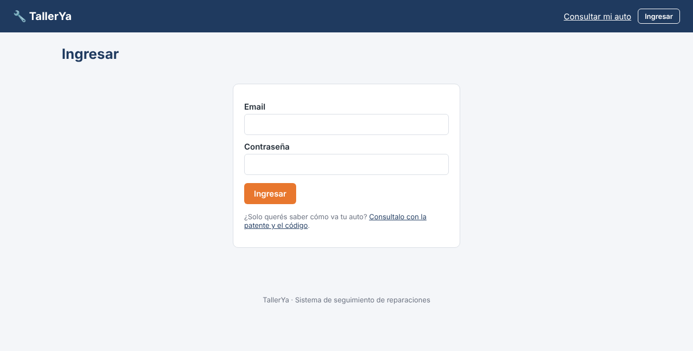 |
| 2 | Consultar mi auto (patente + código) | Visitante | 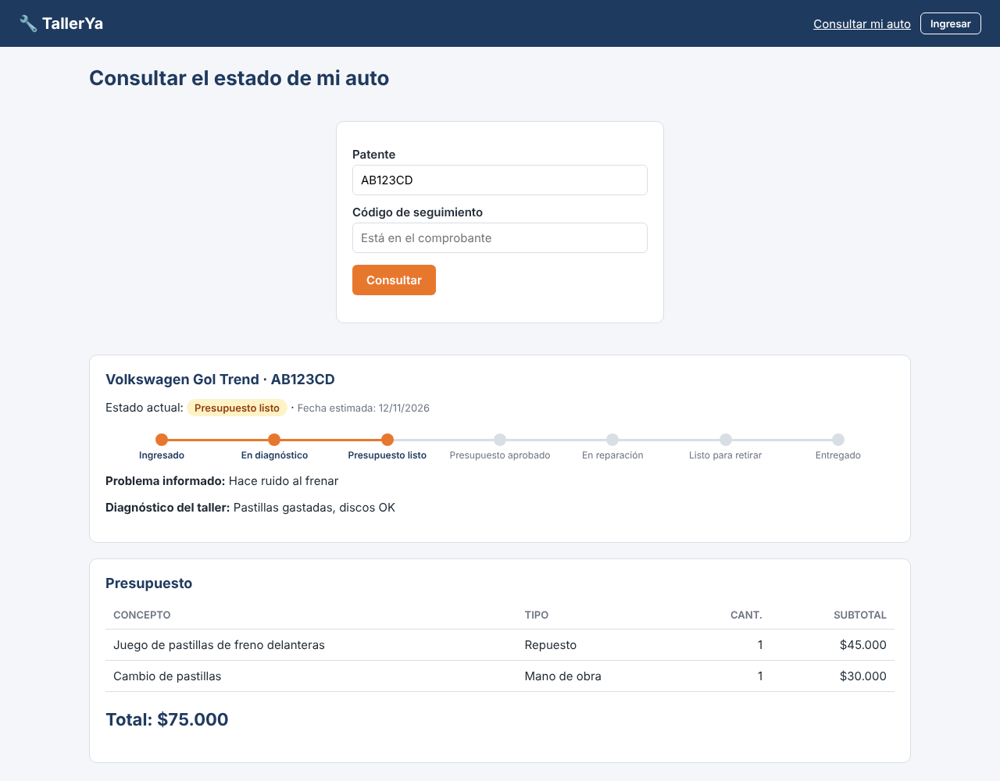 |
| 3 | Panel del taller | Taller | 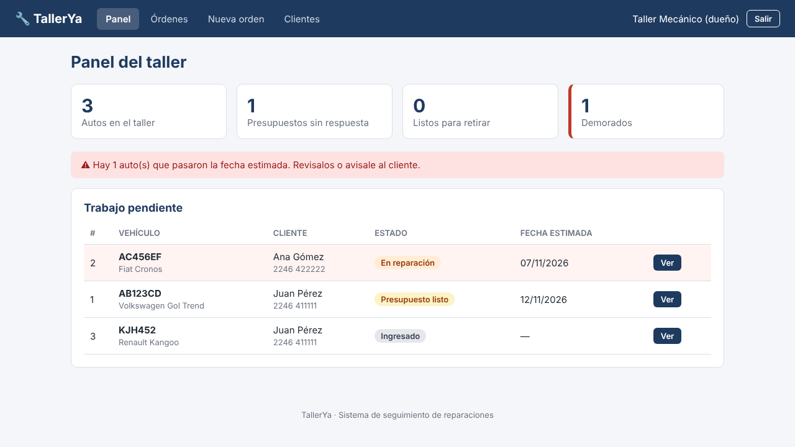 |
| 4 | Órdenes (filtro y búsqueda) | Taller | 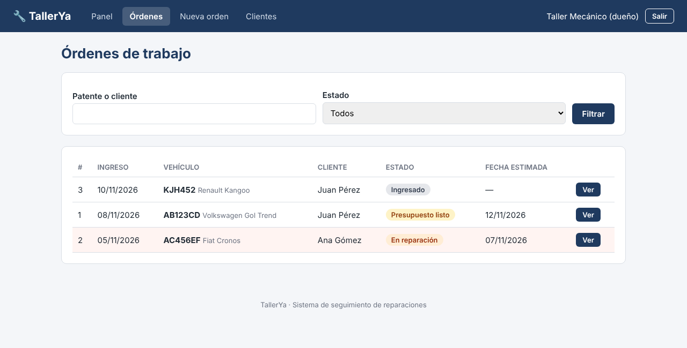 |
| 5 | Nueva orden | Taller | 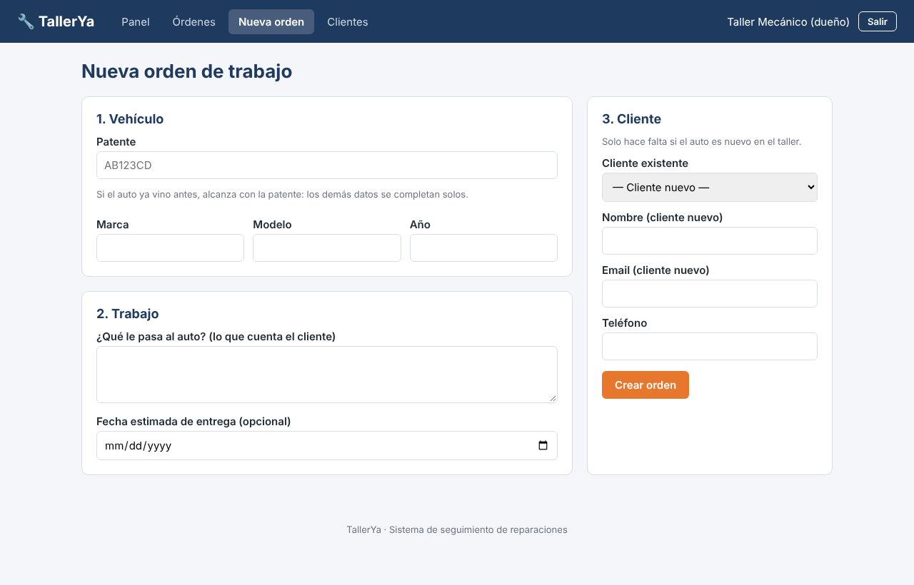 |
| 6 | Detalle de la orden | Taller | 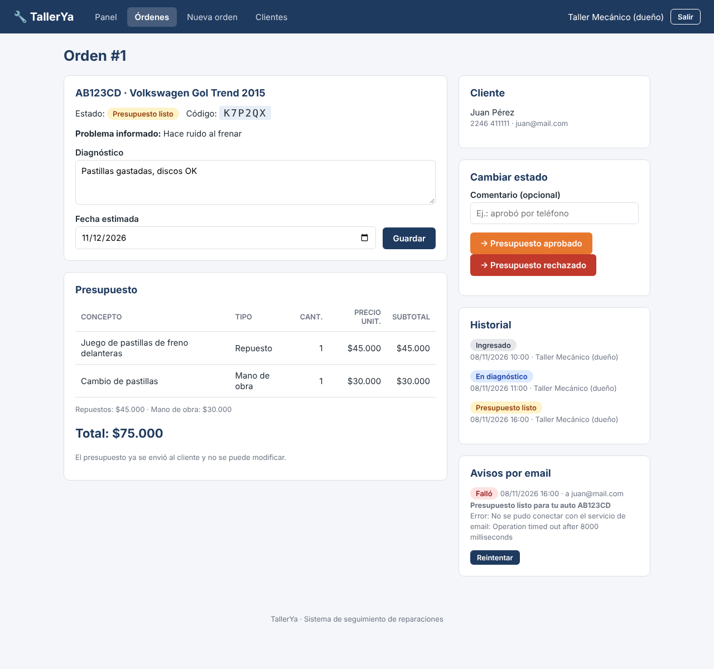 |
| 7 | Clientes | Taller | 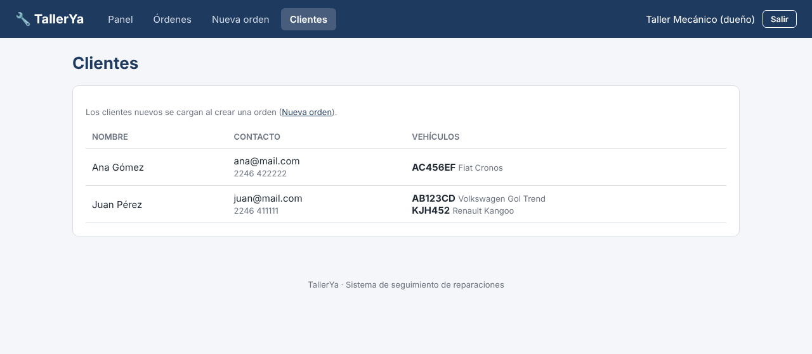 |
| 8 | Mis autos | Cliente | 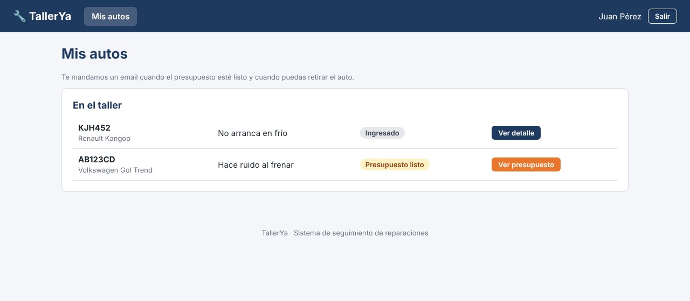 |
| 9 | Presupuesto y aprobación | Cliente | 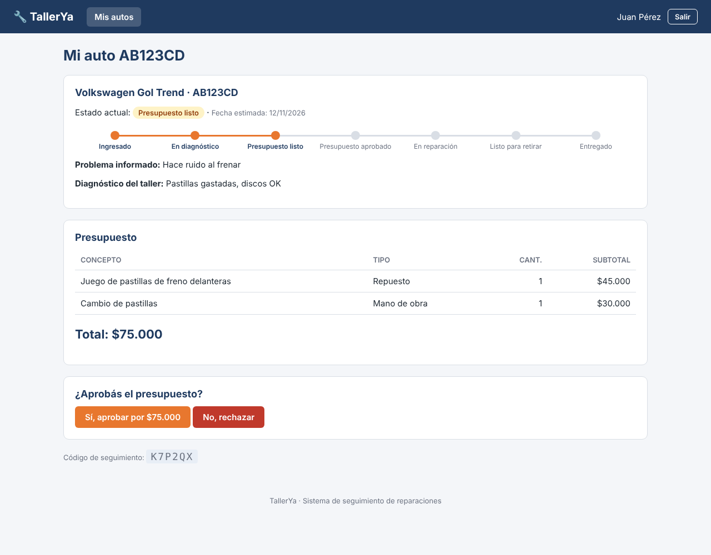 |

## 5. Mapa de navegación

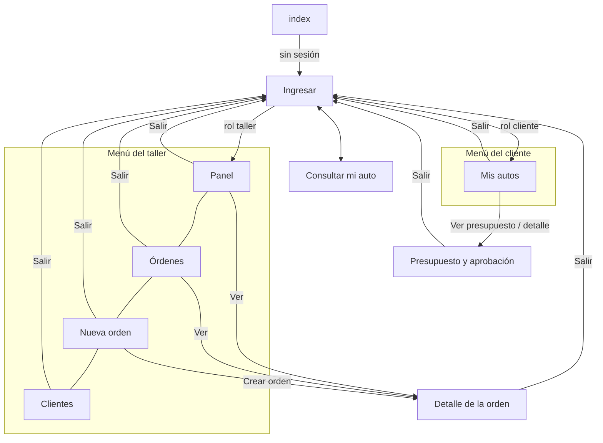

## 6. Tecnologías elegidas y por qué

| Tecnología | Por qué |
|---|---|
| **PHP 8 sin framework** | Es lo que ya sabemos usar, así podemos explicar cada línea en la defensa. Un framework (Laravel) agregaría muchas cosas que no necesitamos y que no podríamos justificar en 4 semanas. |
| **MySQL** | Los datos son relacionales (cliente → vehículo → orden → ítems) y necesitamos claves foráneas y transacciones. Lo da gratis el hosting. |
| **HTML + CSS propio** | Pocas pantallas; con una sola hoja de estilos nos aseguramos de que todo el sitio se vea igual. |
| **SMTP de Gmail** | Gratis, y el email sale autenticado desde la cuenta del taller. InfinityFree no permite `mail()` de PHP ni la API de Telegram, y Brevo rechaza un Gmail como remitente sin dominio propio. |
| **InfinityFree** | Hosting gratis con PHP y MySQL para tener una URL pública (extra del TP). |
| **Git + GitHub** | Obligatorio en el TP; cada integrante trabaja en su módulo y se ven los commits de los tres. |
| **Pruebas con un corredor propio en PHP** | Corren con `php tests/run.php` sin instalar nada (PHPUnit necesita Composer). |

## 7. Metodología

Usamos **Kanban** con iteraciones de una semana que coinciden con las entregas:
- Tablero con columnas *Por hacer / Haciendo / Revisión / Hecho* (GitHub Projects).
- Límite de 2 tareas en *Haciendo* por persona.
- Cada integrante sube su parte y otro integrante la revisa.
- Al inicio de cada clase revisamos la devolución del docente y agregamos tareas al backlog.

Elegimos Kanban y no Scrum completo porque somos 3 personas: no tiene sentido tener roles de Scrum Master y Product Owner, pero sí nos sirve ver el flujo de tareas y no tener demasiadas abiertas.

## 8. Backlog

| ID | Tarea | HU | Responsable | Semana | Estado |
|---|---|---|---|---|---|
| T01 | Crear repositorio, estructura de carpetas y `.gitignore` | — | Di Prinzio Pedro | 2 | Hecho |
| T02 | Base de datos: `schema.sql` y `seed.sql` | — | Devia Lautaro | 2 | Hecho |
| T03 | Login, sesión y permisos por rol | — | Ruesga Lautaro | 3 | Hecho |
| T04 | Layout común y hoja de estilos | — | Ruesga Lautaro | 3 | Hecho |
| T05 | Alta de orden con vehículo y cliente | HU01 | Devia Lautaro | 3 | Hecho |
| T06 | Presupuesto: agregar/quitar ítems y totales | HU02 | Devia Lautaro | 3 | Hecho |
| T07 | Reglas de estados e historial | HU03, HU04 | Devia Lautaro | 3 | Hecho |
| T08 | Envío de emails por Gmail SMTP + manejo de errores | HU03 | Di Prinzio Pedro | 3 | Hecho |
| T09 | Registro de avisos y reintento | HU03 | Di Prinzio Pedro | 3 | Hecho |
| T10 | Vista del cliente y aprobación | HU04, HU07 | Ruesga Lautaro | 3 | Hecho |
| T11 | Consulta pública con patente y código | HU05 | Ruesga Lautaro | 3 | Hecho |
| T12 | Panel con alerta de demorados | HU06 | Devia Lautaro | 3 | Hecho |
| T13 | Listado con filtro y búsqueda | — | Devia Lautaro | 3 | Hecho |
| T14 | Publicar en InfinityFree y configurar Gmail | — | Di Prinzio Pedro | 3 | Hecho |
| T15 | Informe teórico y exposición | — | Los tres | 3 | Por hacer |
| T16 | Pruebas automatizadas (mínimo 5) | — | Los tres | 4 | Hecho |
| T17 | Plan de pruebas y manual de usuario | — | Los tres | 4 | Por hacer |
| T18 | Retrospectiva | — | Los tres | 4 | Por hacer |
| T19 | Preparar la defensa (cada uno estudia los módulos de los demás) | — | Los tres | 4 | Por hacer |

> Actualizar los estados y los nombres de los responsables con lo que hagan de verdad. El historial de commits tiene que coincidir con esta asignación.
